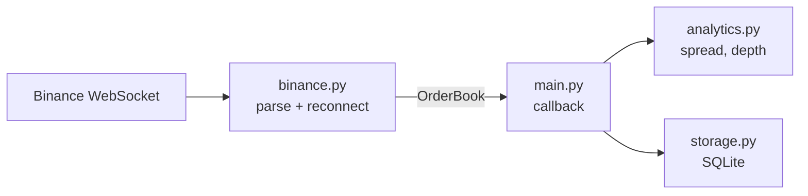

# Order Book Feed Handler

A small Python market data feed handler. It connects to a live crypto exchange feed (Binance), converts each message into an exchange-independent format, computes market metrics (spread and depth), and stores the results for later analysis.

I built it to understand the core problem behind institutional trading infrastructure: every exchange publishes data in its own format, and the rest of a system needs one clean, consistent stream.

> **Status:** working prototype, actively being improved. See [Limitations](#limitations) and [Roadmap](#roadmap).

## What it does

1. **Connects** to Binance's public WebSocket depth stream (no account or API key needed).
2. **Normalises** each message into a standard `OrderBook` snapshot, so nothing outside the exchange adapter ever sees raw JSON.
3. **Analyses** each snapshot: best bid and ask, spread, and depth across the top N price levels.
4. **Stores** the results in SQLite so you can look at how the market changes over time.
5. **Recovers** from dropped connections automatically, using exponential backoff.

Example output (replace this with your own real output):

```
BTCUSDT spread=0.01 bid_depth=4.213 ask_depth=3.870
BTCUSDT spread=0.01 bid_depth=4.198 ask_depth=3.902
BTCUSDT spread=0.02 bid_depth=4.150 ask_depth=3.911
```

## Terms

- **Order book:** an exchange's live list of waiting buy orders (bids) and sell orders (asks), each with a price and quantity.
- **Spread:** the gap between the best (lowest) ask and the best (highest) bid. A small spread usually means a liquid market.
- **Depth:** the total quantity available across the top N price levels on one side of the book.

## Architecture



The exchange-specific code is isolated in one module. Adding another exchange means writing another adapter that returns the same `OrderBook` model, with no changes to the analytics or storage code.

### Project layout

```
orderbook-feed/
  models.py            # Level and OrderBook dataclasses
  binance.py           # WebSocket connection, parsing, auto-reconnect
  analytics.py         # spread() and depth()
  storage.py           # SQLite persistence
  main.py              # wires the pieces together
  tests/
    test_analytics.py  # unit tests, including empty-book edge cases
  requirements.txt
  README.md
```

### Design decisions

- **`Decimal`, not `float`.** Prices and quantities are kept as `Decimal` to avoid floating-point rounding errors, and stored in SQLite as text for the same reason.
- **Parsing is separate from networking.** `parse()` is a pure function, so it can be tested without a connection.
- **A callback (`on_book`) decouples the feed from what you do with it.** The adapter handles the connection; `main.py` decides what to do with each snapshot.
- **Empty books are handled explicitly.** If either side of the book is empty, `spread()` returns `None` instead of raising an error.

## Getting started

Requires Python 3.10 or later.

```bash
git clone https://github.com/Beatrice-cyber/<repo-name>.git
cd <repo-name>
python -m venv .venv
source .venv/bin/activate        # on Windows: .venv\Scripts\activate
pip install -r requirements.txt
python main.py
```

Stop it with `Ctrl+C`. Snapshots are saved to `feed.db`; inspect them with:

```bash
sqlite3 feed.db "SELECT * FROM snapshots ORDER BY id DESC LIMIT 5;"
```

> Binance may be unavailable in some regions. If the connection is refused, the feed URL in `binance.py` is the only thing that needs changing for another endpoint.

## Testing

```bash
python -m pytest
python -m pytest --cov=analytics --cov=models --cov=binance --cov-report=term-missing
```

The tests build order books by hand, so they run without a network connection. They cover normal books, books with no bids or no asks, empty books, and depth calculations with fewer levels than requested.

Current coverage: **[X]%** (replace with the figure from your own run).

## Limitations

This is a learning project, and I want to be clear about what it doesn't do:

- **It uses Binance's partial depth snapshot stream**, which sends the top 5 price levels each update. It does not maintain a full local order book from incremental updates, which is what a production system would do (and it requires sequence-number checking to detect missed messages).
- **Timestamps are local receive times**, not exchange timestamps, so latency and ordering aren't measured precisely.
- **One exchange and one symbol** (BTCUSDT) at the moment.
- **SQLite** is fine for a prototype but not for high-volume storage.
- **It is read-only.** It consumes market data and does not place orders or hold credentials.

## Roadmap

- [ ] Add a Coinbase adapter that returns the same `OrderBook`, to test the normalisation approach across two exchanges
- [ ] Maintain a full order book from incremental updates, with sequence-gap detection and resync
- [ ] Support multiple symbols concurrently
- [ ] Move storage to PostgreSQL and chart spread over time
- [ ] Add a CI workflow (GitHub Actions) that runs the tests and publishes coverage
- [ ] Re-implement the feed handler in Go, with one goroutine per exchange

## What I learned

- Real-time data arrives in inconsistent formats, so a clear internal model keeps the rest of the code simple.
- Boundary cases such as empty books, missing sides and short lists are where bugs hide, so they deserve their own tests.
- Reconnection logic matters as much as the happy path, because live connections drop.

## Tech

Python, asyncio, websockets, `decimal`, SQLite, pytest.
